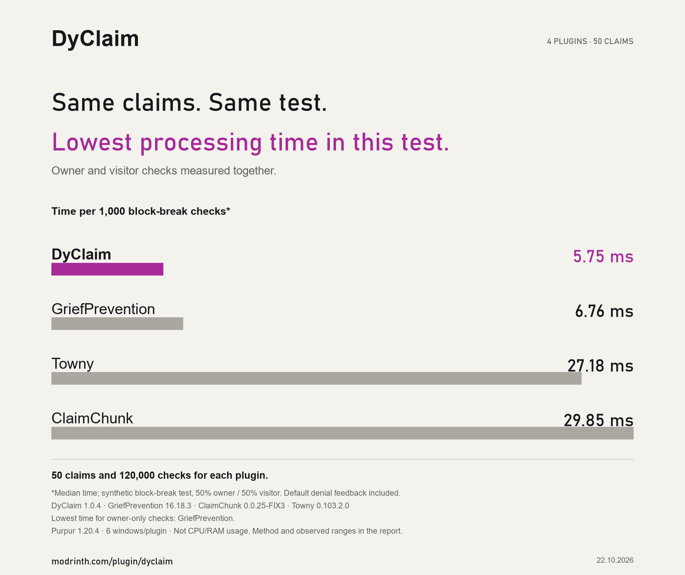

# DyClaim — Chunk Claiming Made Simple

Protect your builds. Share your land. Manage your claims.

DyClaim is a chunk-based land protection plugin for survival, SMP and economy servers. Claim land with a command, choose who can use it, and manage protection settings without a GUI.

DyClaim combines temporary trust, shared ownership, player trading, automatic claiming and configurable protection with the familiar command-based workflow. **Version 1.0.4** adds paged help, the `/dyc`, `/cltp` and `/dyca` shortcuts, and clearer English and Turkish messages. Existing command aliases, English/Turkish selection and claim data are preserved.

**Zero bloat.** No complex GUIs, no unnecessary features. Just clean, fast chunk protection that works. Optional systems stay disabled until you choose to enable them.

[Modrinth](https://modrinth.com/plugin/dyclaim) · [GitHub](https://github.com/DyPlugin/DyClaim)

## Downloads and installation

| Your server | File |
|---|---|
| Bukkit, Spigot, Paper or Purpur | `DyClaim-1.0.4.jar` |
| Folia | `DyClaim-1.0.4-Folia.jar` |

Install **one** backend JAR per server. Stop the server and back up `plugins/DyClaim` before replacing an older JAR. Keep the existing data folder. Both builds use the same schema-2 claim data and EN/TR commands. There are no proxy companions in this release.

[Releases and checksums](https://github.com/DyPlugin/DyClaim/releases) · [Platform and verification notes](docs/platforms.md) · [Command improvements](docs/claim-management.md)

## A measured look at protection



On Purpur 1.20.4 with 50 claim areas, DyClaim had the lowest observed median in this synthetic workload: 50% owner-allowed and 50% visitor-blocked block-break checks, including default denial feedback. GriefPrevention was faster in the owner-only checks. These are event-processing durations, not CPU or RAM usage, and do not establish superiority across all workloads.

[Method, results and limitations](docs/benchmark-50-claims.md)

## Features

### Claiming and economy

- Claim the chunk you are standing in with `/claim`.
- Configure prices, cooldowns, total limits, world limits and spacing between different owners.
- Use Vault and an economy provider for purchases and server refunds.
- Sell claims back with `/claim sell`; refunds use the claim's recorded refund basis.
- Adjust prices with safeguards against repeated price-difference refunds.
- Enable automatic claiming while walking into eligible chunks. Balance, limit and acquisition checks still apply.
- Core claiming works without Vault. The player marketplace requires an active economy provider; free automatic claiming requires explicit configuration.

### Protection you can configure

Protect building, containers and supported entity interactions, with separate settings for PvP, explosions, mob explosions, hostile mob spawning, villager damage, visitor doors and trapdoors.

Villager damage by players is blocked by default, including owner attacks and player projectiles. Trading remains available. Farmland has separate visitor and mob trampling policies.

Boundary checks cover piston movement, fluid flow and hopper transfers between different owners or claimed land and wilderness. Automation between claims with the same primary owner remains available. Double-chest access checks both halves.

Server owners can define global and world defaults, force protection values and lock player toggles. External redstone checks cover nearby power effects; they do not isolate every possible circuit.

Optional mob cleanup checks loaded claim chunks with a bounded workload. Scope, excluded mob types and named/tamed exceptions are configurable. It may also remove eligible mobs already inside a claim.

### Trust and ownership

- Permanent trust using the original `/claim trust <player>` command.
- Temporary trust with durations such as `30m`, `2h` and `7d`.
- Separate access rights for building, containers, doors, trapdoors, redstone, entities and teleportation.
- One coowner per claim, added only after accepting an invitation. Coowned claims count toward acquisition limits.
- Ownership transfers that require the recipient's acceptance and renewed acquisition checks.
- Optional, experimental SimpleClans trust.

Trust does not grant ownership or selling rights. A coowner can manage trust and claim settings but cannot sell, transfer or replace the primary owner. Successful transfers clear previous trust, coownership, clan grants and market listings.

### Player marketplace

Enable `/claim market` to let players list and purchase claims. Configure minimum/maximum prices and a tax deducted from the seller's proceeds; tax is removed from circulation.

Purchases recheck ownership, price, permissions, bans and limits when confirmed. A persistent transaction journal records payment stages. Uncertain provider outcomes lock the affected claim for reconciliation rather than repeating payments automatically.

### Names, teleportation and borders

Give claims names, set safe spawn points and teleport by list number or name. Destinations are checked again when the teleport executes; warmup and movement cancellation remain available.

Paginated lists show claim names and locations. Claim information shows owners, effective settings and market status; management details require appropriate access.

Claim-entry action bars show the owner and PvP status. Java players get particle borders; an optional Floodgate path provides client-side block borders for Bedrock players. Visualization tasks have duration, distance and particle limits and are cleaned up on exit or shutdown.

### Administration and warnings

Enable or disable claiming, manage player claims, adjust prices, maintain a world blacklist and reload configuration. Additional tools include:

- Session protection bypass, separate from command permissions.
- Temporary or permanent bans on acquiring claims.
- Preview-and-confirm inactive claim cleanup with backups and bounded batches.
- Optional scheduled cleanup, with protections for online owners, active coowners and exemptions.
- Owner/coowner warnings for unauthorized visitors, with a shared cooldown and persistent sanctions.

Warnings are disabled by default. Their default rules are three valid warnings within 180 seconds, a 60-second cooldown and a two-day sanction. Server-ban and claim-entry-ban modes are configurable.

## English and Turkish

With `lang: auto`, DyClaim uses a player's saved language preference or their Minecraft language. Turkish clients receive Turkish messages and TAB suggestions; other client languages fall back to English.

TAB shows only the effective language. Both languages remain accepted when typed, including operation words and trust permissions.

Players can select `/claim lang en`, `/claim lang tr` or `/claim lang auto`. An administrator's `/claim admin lang en|tr` applies to everyone and takes priority over individual preferences. `/claim admin lang auto` restores automatic selection. Localized aliases are accepted without changing the active suggestion language.

## Player commands

Arguments in `<angle brackets>` are required; `[square brackets]` are optional. Use TAB for suggestions permitted by your permissions. `/dyc` is a short form of `/claim` (for example `/dyc list`).

| Command | Purpose |
|---|---|
| `/claim` | Claim your current chunk |
| `/claim sell` | Sell the current claim back to the server |
| `/unclaim` | Remove the current claim through the confirmation/refund flow |
| `/claim trust <player> [duration]` | Grant permanent or temporary trust |
| `/claim trust <player> <right> <allow\|deny>` | Change a trusted player's access rights |
| `/claim untrust <player>` | Remove player trust |
| `/claim trustlist` | View current trust |
| `/claim coowner add <player>` | Invite one online coowner |
| `/claim coowner remove` | Remove the coowner |
| `/claim transfer <player>` | Offer ownership to an online recipient |
| `/claim market list <price>` | List the current claim for sale |
| `/claim market cancel` | Remove the listing |
| `/claim market buy` | Purchase the listed claim you are standing in |
| `/claim auto [on\|off]` | Toggle automatic claiming while walking |
| `/claim name <name>` | Name the current claim |
| `/claim setspawn` | Save a safe spawn inside the claim |
| `/claim tp <number\|name>` | Teleport to a claim from your list |
| `/cltp <number\|name>` | Short form of `/claim tp`, available to every player |
| `/claim list [page]` | View a paginated claim list; optional name/world/sale filters |
| `/claim info` | Inspect the current claim |
| `/claim see` | Display the nearby outer outline of connected claims |
| `/claim pvp`, `/claim mob`, `/claim villager` | Toggle the corresponding unlocked setting |
| `/claim explosion [mob]` | Toggle ordinary explosions, or select `mob` for mob explosions |
| `/claim doors`, `/claim trapdoors` | Toggle visitor access |
| `/claim warn <player>` | Warn an unauthorized visitor inside your claim |
| `/claim lang <auto\|en\|tr>` | Select your language |
| `/claim help [page]` | Show player help, eight commands per page |
| `/confirm`, `/cancel` | Accept or reject a pending action |

Trust rights: `build`, `containers`, `doors`, `trapdoors`, `redstone`, `entities`, `teleport`. The original trust command grants all these rights. Durations use `m` for minutes, `h` for hours and `d` for days; permanent access uses `permanent` or its localized equivalent.

The old `trustperm` / `güvenizin` and `mobexplosion` / `mobpatlama` commands remain accepted aliases. Help and root TAB suggestions use the grouped forms above. Turkish examples: `/claim güven Alex sandıklar reddet` and `/claim patlama mob`.

## Admin commands

Use `/claim admin` or `/claim admin help [page]` for help. `/dyca` is a short form of `/claim admin` (for example `/dyca reload`); it requires `dyclaim.admin` and is hidden from other players. Console senders can use `enable`, `disable`, `price`, `pricediff`, `cooldown`, `prefix`, `economy`, `lang`, `blacklist` and `reload`, with the `dyclaim.admin` permission. Console help and TAB show this supported scope; player-specific administration and confirmation flows remain player-only. In the server console, omit the leading slash: `claim admin reload` (Turkish: `claim admin yenile`).

Common tools include `enable`, `disable`, `price`, `pricediff`, `cooldown`, `prefix`, `economy`, `lang`, `blacklist`, `reload`, `give`, `delete`, `bulksell`, `bypass`, `ban`, `unban`, `purge` and `transactions`.

Examples:

```text
/claim admin bypass off
/claim admin ban Alex 7d
/claim admin unban Alex
/claim admin purge 30
/claim admin transactions
/claim admin lang tr
/claim admin reload
```

Inactive cleanup removes claim records, not world blocks. Deletion and bulk operations use previews, confirmation and backups. Bypass does not exempt a player from acquisition bans, prices or limits.

## Permissions

| Permission | Default | Purpose |
|---|---|---|
| `dyclaim.player` | Everyone | Player command permission group |
| `dyclaim.admin` | OP | Core administration and player permissions; includes bypass permission |
| `dyclaim.admin.bypass` | OP | Permission to use protection bypass |
| `dyclaim.admin.purge` | OP | Additional permission for inactive cleanup |
| `dyclaim.admin.purge.exempt` | OP | Exemption from inactive cleanup |
| `dyclaim.warn.exempt` | OP | Exemption from visitor-warning sanctions |

`/claim admin diagnose` works in console and for permitted administrators. It reports version, backend, storage, economy and installed integrations without secrets or filesystem paths. Turkish alias: `/claim admin tanı` (ASCII `tani` also works). Installed integrations are not a compatibility certification.

Individual player permissions are available for `claim`, `sell`, `see`, `info`, `list`, `trust`, `teleport`, `settings`, `coowner`, `transfer`, `market`, `auto`, `name`, `setspawn` and `warn`, prefixed with `dyclaim.`. They default to everyone; configuration can still disable a feature. See [plugin.yml](src/main/resources/plugin.yml) for the complete permission definition.

## Compatibility

The plugin compiles to **Java 17 bytecode**. Run the Java version required by your server; Java 17 is not the runtime requirement for every Minecraft version.

Current 1.0.3 automation and isolated-server checks are documented in [1.0.3 verification](docs/verification-1.0.3.md). The following table is historical evidence from earlier releases.

| Previously tested server | Tested Java |
|---|---|
| Purpur 1.20.4, build 2176 | Java 21 |
| Paper 26.2, build 129 | Java 25 |
| Purpur 26.2, build 2633 | Java 25 |
| Spigot 26.2, BuildTools revision 4648 | Java 25 |

The v1.0.0 release passed live claim, ownership, language and protection scenarios across these runtimes. Version 1.0.1 passed 108 automated tests and additional startup, reload, data persistence and update-notification checks on Purpur 1.20.4 and Paper 26.2. The 1.0.2 build passes 148 automated tests and targeted Purpur 1.20.4 checks for console reload, grouped commands, legacy aliases, localized help/TAB and preservation of custom messages. Earlier 1.0.2 checks covered restart persistence, visitor access and ghast projectile block protection. The full historical server matrix was not repeated for 1.0.2. Intermediate Minecraft patch releases were not individually tested. Tests on 26.2 used Java protocol clients through ViaVersion/ViaBackwards; direct 26.2 and Bedrock client tests were not performed. See the [test matrix](docs/compatibility-test.md).

### Optional integrations

| Plugin | Integration |
|---|---|
| Vault + economy provider | Claim payments, refunds and player marketplace |
| WorldGuard | Region overlap checks |
| GriefPrevention | Claim overlap checks |
| Towny | Town overlap checks |
| Lands | Land overlap checks |
| Residence | Residence area overlap checks |
| GriefDefender | Claim overlap checks |
| Floodgate | Bedrock detection and block-border visualization path |
| SimpleClans | Experimental clan trust, enabled separately |

No integration is required for core claiming. Installed protection hooks are detected automatically; an unavailable or failing detected hook blocks acquisition rather than allowing an unchecked overlap. Actual provider-version compatibility and Bedrock visualization require testing with your chosen integrations; they are not covered by the completed core-server matrix.

## Installation and configuration

1. Stop the server and place `DyClaim-1.0.4.jar` in `plugins/`.
2. Start the server to generate `plugins/DyClaim/`.
3. Edit `config.yml` and, if desired, the English/Turkish message files.
4. Run `/claim admin reload` as a permitted player, or `claim admin reload` in the server console.

Marketplace, auto claim, warnings, mob cleanup, scheduled purge and clan integration are **disabled by default**. Enable the features you want and choose their policies before use. Invalid configuration reloads retain the previous valid settings.

### Update notifications and upgrading from v1.0.0

DyClaim periodically checks Modrinth for the newest compatible public stable release and notifies administrators with a direct version link. Checks run every six hours by default, failed requests retry after ten minutes, and repeated notices are avoided within a login session. Settings apply on reload. See [update checking](docs/update-checking.md).

Existing v1.0.0 claim data remains compatible. Missing configuration options are added without overwriting existing settings. Back up your JAR and complete DyClaim data folder before upgrading.

Version 1.0.3 keeps schema 2 and the existing configuration/message merge behavior. Its checks are recorded separately in [1.0.3 verification](docs/verification-1.0.3.md).

**Beta and original v1.0.0 users must update manually once.** Their installed update-checker defect cannot be repaired remotely. The checker uses Modrinth releases; publishing a GitHub release alone does not trigger Modrinth notifications. No automatic JAR replacement is performed.

### Upgrading from Beta

Back up the old JAR and the entire DyClaim data folder together before upgrading. Beta claims migrate automatically with a preserved old-format backup. Existing ownership and trust are retained, and claims receive stable IDs in the versioned format.

Rolling back requires a matching old-format data backup; replacing only the JAR is insufficient. External economy balances are not rolled back by restoring plugin files. Read the [upgrade and recovery guide](docs/upgrade-and-rollback.md).

## Build and contribute

Build from source with the bundled Gradle wrapper:

```text
Windows:      gradlew.bat clean build
Linux/macOS:  ./gradlew clean build
```

Run `gradlew.bat foliaJar verifyPlatformArtifacts` (or `./gradlew foliaJar verifyPlatformArtifacts`) to also build and check the Folia distribution. Outputs: `build/libs/DyClaim-1.0.4.jar` and `build/libs/DyClaim-1.0.4-Folia.jar`. Maintained by **Claww**. Issues, contributions and feature requests are welcome at [DyPlugin/DyClaim](https://github.com/DyPlugin/DyClaim).

Licensed under the custom [DyClaim Source-Available License 1.0](LICENSE).
Use and modification are permitted, including on commercial servers. Redistribution must be free, retain attribution and provide the corresponding source under the same terms. Paid distribution requires separate written permission. Third-party licenses and rights granted for earlier distributions remain unaffected.


